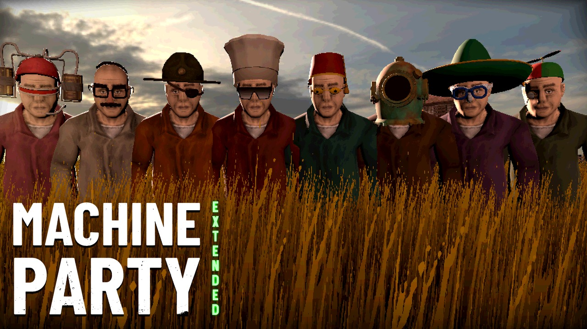
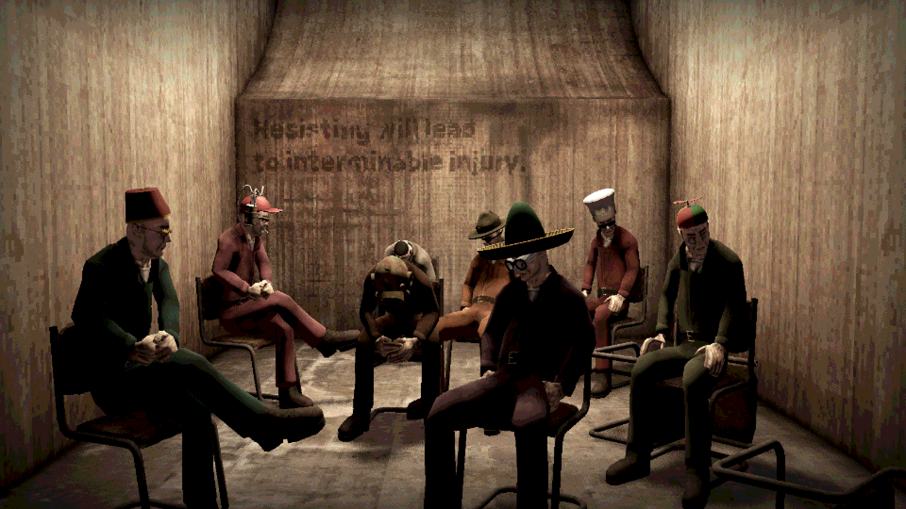
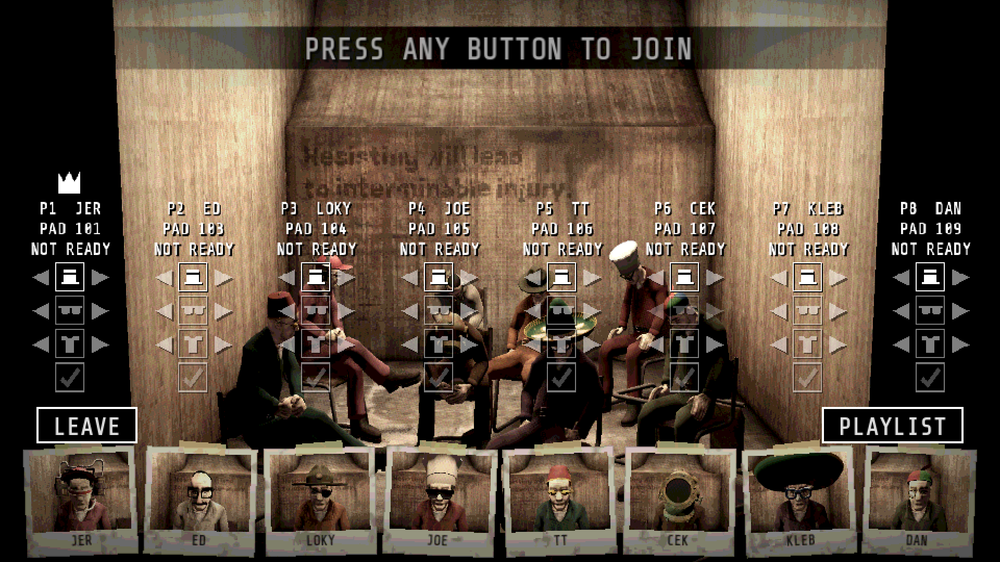
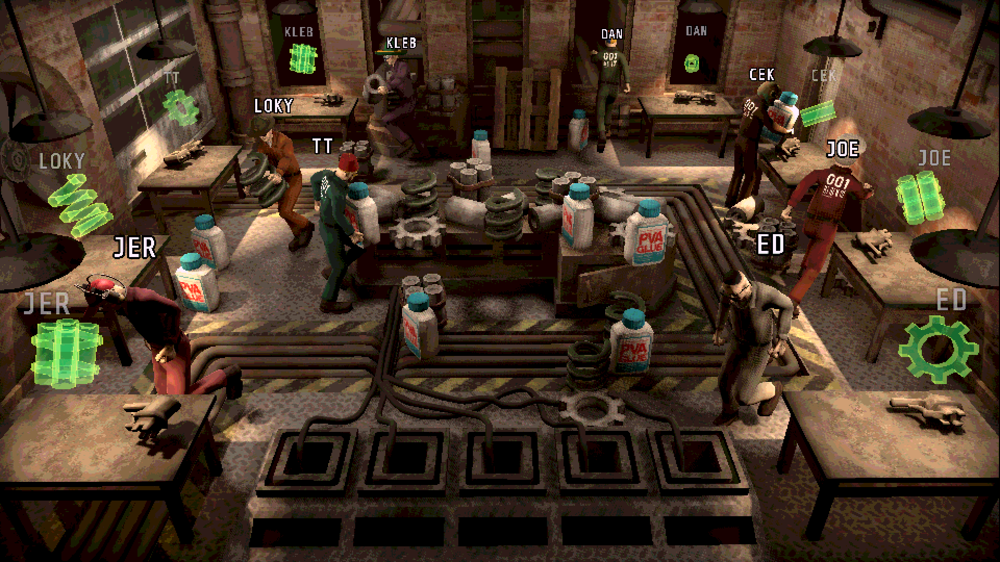
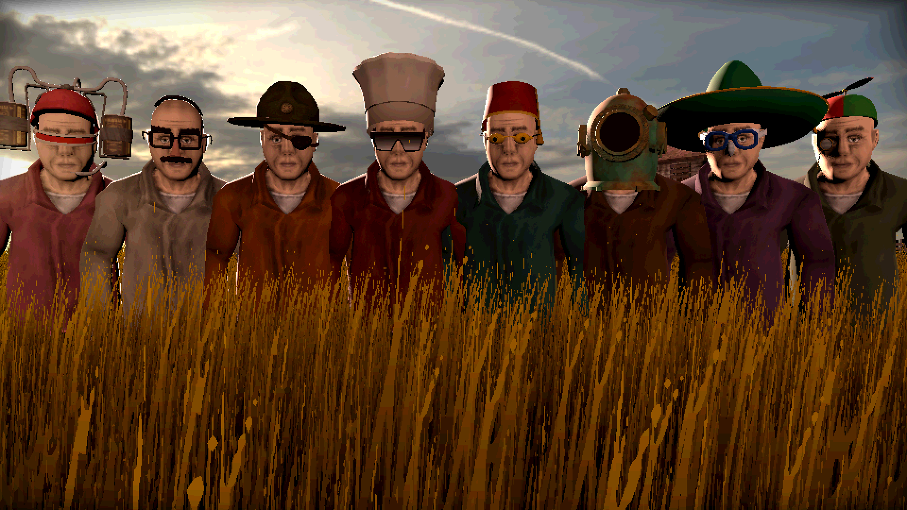
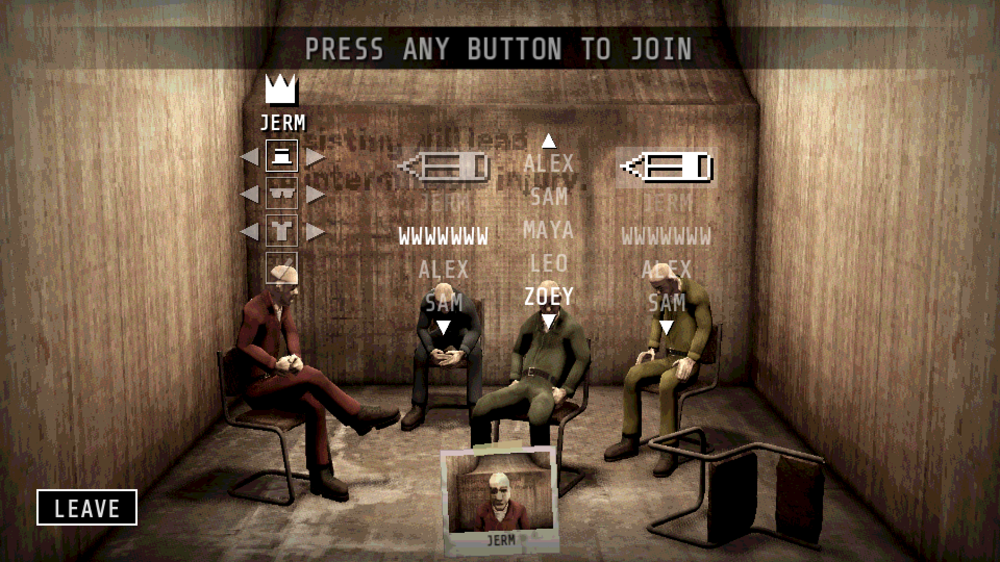
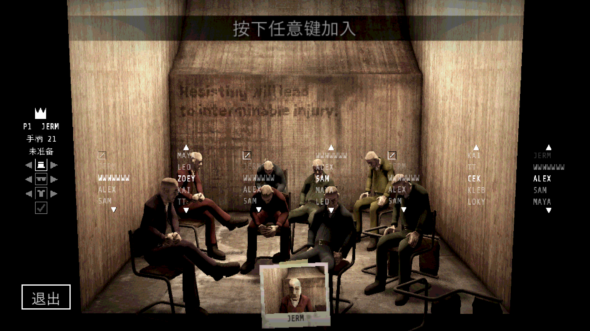

# Machine Party: Extended

### [⬇ Download Machine Party: Extended](https://github.com/therenow9/MachineParty-Extended/releases/download/v1.1.0/Machine-Party-Extended-1.1.0.zip) (6.4 MB)
### [⬇ Download with GameCube Controller Support](https://github.com/therenow9/MachineParty-Extended/releases/download/v1.1.0/Machine-Party-Extended-1.1.0-with-GameCube.zip) (6.6 MB)

**[▶ Watch the trailer](https://youtu.be/rwQyxxX0Bdo)**

[All downloads](https://github.com/therenow9/MachineParty-Extended/releases/latest), including each mod on its own.

Up to 8 players in Machine Party, on one couch or online, with fixes aimed at local split-screen play. **Version 1.1.0,** built for [MachinePartyModLoader](https://github.com/Krunk-theduck/MachinePartyModLoader) (MPML).

It comes with [Better Couch Lobby](mods/README.md#better-couch-lobby) and [More Cosmetics](mods/README.md#more-cosmetics), so you don't need to install either one separately. Each is also on Nexus Mods on its own: [Better Couch Lobby](https://www.nexusmods.com/machineparty/mods/15), [More Cosmetics](https://www.nexusmods.com/machineparty/mods/16).

AI assisted: written with Claude (Anthropic's AI model) under my direction and tested by me in the game.

## Screenshots

## What it adds

- **All 15 minigames at up to 8 players:** [the full list](#the-minigames) of what changes in each is below.
- **8 seats in the local lobby,** with seats 5–8 in a second row behind the original four, and eight player cards side by side along the bottom.
- **An 8-slot session intro.** With 5 to 8 players, every player's tube goes into its own socket and every name lights on its own bar.
- **The wheat field with 5 to 8 players.** Players 5 to 8 start in a second row, in the gaps, so everyone stays in view.
- **A cleaner split-screen HUD.** No device list, and in Chisel Gauntlet, The Filter and Inside Job each screen's tag is just the player's name.
- **Faster split screen.** Views nobody could see are no longer drawn, and Chisel Gauntlet's and Inside Job's split-screen shadows cost about half the work. In Inside Job's split screen, each flashlight's glow around the hand casts no shadow; the beam still does.
- **EXTENDED on the title screen,** in green down the right edge of the logo.
- **Chinese, Simplified and Traditional:** with the game set to either, Extended's own text is in that language too: the lobby cards, The Filter's scoreboard, Duck Hunt's hunter lines and HUD, and the online refusal messages.
- **Four of the game's own bugs fixed, in every room,** also one with players without Extended. Leaving Debris Platforms while a deck is blinking no longer freezes the game, leaving any minigame as its 3-2-1 countdown ticks no longer crashes it, a Spine Breaker spider thrown into a pillar no longer stalls the round, and a double press of Host, Local or Customization in the main menu no longer crashes it.

## The minigames

Each change is measured against the game's own minigame. Couch and online games play the same versions, unless a line says otherwise. While anyone in the room lacks Extended, every minigame is the game's own, apart from the three bug fixes above ([Online play](#online-play)). In any minigame, a player who leaves before a round starts no longer ends it.

### Chisel Gauntlet

- **5 to 8 players:** extra seats between the game's four, at 45 degrees, each with its own desk and sign. The shotgun checks the seats in order around the circle.
- **On the couch at 5 to 8:** the split screen is 3 columns at 5 or 6 players, and 4 at 7 or 8.
- **The memorise phase:** the other players are hidden while you memorise, and the camera at an added seat swings toward its screen.
- **Cubes follow the stick on screen,** diagonals included: a controller press moves to the nearest uncut cube that way as your screen shows it. Mouse and keyboard are unchanged.
- **Scoring:** the game's own.

### Debris Platforms

- **Eight decks, at any player count.** All eight stand on one ring, and each player has a deck of their own. Debris drops over each player's deck.
- **On the couch at 5 to 8: a fairer view from the back seats.** The decks spread out sideways in a flatter oval, with the crushers above the camera.
- **A crusher that slams down fades,** half a second later, to 30% opacity, and still blocks debris and players. Couch games of any size, and online games of 5 to 8.
- **Rocks reach the far side at 5 to 8.** A throw at an opponent you face is made stronger, up to 1.75 times, when the game's throw would fall short. Its direction never changes, and short throws stay as they were.
- **Debris keeps coming.** A cube left still and unheld for 30 seconds is recycled. In the game's own, resting cubes use up the supply.
- **Scoring:** falls score as in the game. The survivor scores one more than the last to fall, not two.

### Duck Hunt

- **Hunters:** 2 at 6 to 8 players, standing 4 m apart; 1 below that. Each player hunts once, so 6 players play 3 rounds, and 7 or 8 play 4.
- **7 players' last round** has a lone hunter with 18 rounds and faster fire, shouting "HUNT THEM ALL!".
- **Ducks:** added start points past the game's 3, as many as the round needs.
- **The hunter's gun by player count:**

  | Players | Magazine | Time between shots |
  | --- | --- | --- |
  | 2 to 4 | 10 | 1.30 s |
  | 5 | 12 | 0.92 s |
  | 6 | 7 | 1.88 s |
  | 7 | 8 | 1.30 s |
  | 8 | 10 | 1.30 s |

- **Aim:** a shot from the hip spreads within an 8-degree cone; a scoped shot is exact.
- **The countdown** ends in "HUNT!" or "RUN!" in place of "GO!". Online, the reveal is the game's own line, or "X AND Y ARE THE HUNTERS." for two.
- **On the couch:** ducks on the left half of the screen, hunters on the right, two hunters in quarters. The hunters' prompts fit inside their own screens. With Offline Bots installed, a bot hunter's view follows its aim and zooms when it scopes in.
- **A stuck duck** that holds a direction for 3 seconds without moving is put back 1 m.
- **Scoring: changed.** Ducks that escape score by order, 2 apart, with the first highest. Ducks that are shot score by order too, 2 apart, with the first shot scoring 0. Hunters score 2 per duck shot, plus the damage on any duck that escaped. The minigame's scores count half towards the session total (0.8 at 6 players).

### Firearm Factory

- **The workbenches at 5 to 8 stand along the walls,** so it is clear whose is whose, with each player starting in front of their own: six benches for 5 or 6 players, eight for 7 or 8. Some props make way. 2 to 4 players keep the game's room.
- **Twice the parts at 5 to 8:** 52, not 26.
- **A part can't be dropped onto another player's workbench.** A neighbour's bench no longer gets in the way of using yours. Any player count.
- **Nobody starts stuck:** a player who starts inside a desk or wall is moved out.
- **Scoring:** the game's own.

### Forklift Certified

- **8 bays at 5 to 8 players,** one each: the game's four, and four at the middle of the edges.
- **A bigger yard at 5 to 8.** The warehouse grows 1.3 times in width and depth, and the camera pulls back. The bays, forklifts and crates keep their size. 2 to 4 players keep the game's yard.
- **Crates:** as many as in the game, two per player up to 10, placed in the free space in the middle.
- **Scoring:** the game's own at one player per bay.

### Inside Job

- **8 starting spots, at any player count.** The game shuffles them, so even two players can start on a new one.
- **The syringe can always be found.** One syringe, as in the game; but it now turns up with at least two reachable containers still unsearched, and the two in the sealed room are no longer searchable.
- **Eight "alive" icons** in place of four.
- **Before the hunt, no one can stab.** Online, a search's result goes only to the player who searched.
- **On the couch:** each screen has its player's name tag; the split screen is 3 columns at 5 or 6 players, and 4 at 7 or 8. The hunt hides every name over a head, the syringe holders' too, as it does online.
- **Scoring:** the game's own totals.

### Lethal Rebound

- **8 starting spots, at any player count:** the game's four, and four between them on the same circle.
- **Unchanged:** the roombas and how often they come.
- **Scoring:** the game's own, unless someone leaves mid-round: the survivor then still scores two more than the last out.

### Minefield

- **Starts for each player at 5 to 8,** worked out from the game's four.
- **A corridor 1.2 times wider at 5 to 8,** with its walls and art. The mined area grows with it, 16 m to 19.2 m, at the same density.
- **Scoring: changed.** Everyone scores by order: the first to die 0, the next 1, and so on, then the finishers, with the first to finish highest. Finishing at full health adds 1. The game's points for halfway and for finishing first are gone. The minigame's scores count three quarters towards the session total.

### Smoke Break

- **Up to 8 seats at 5 to 8 players,** re-spaced along the game's arc, with the revolver, blood and crates to match.
- **Players 5 to 8 toss their cigarette butt** when they finish, as players 1 to 4 always did, looking the way the nearest of the game's four seats looks.
- **Unchanged:** the 30-second countdown, and how the revolver picks its target.
- **Scoring: changed.** Finishers score by order: the first as many points as there are players, plus 1; the second one less than the number of players, the third two less, and so on. Anyone who doesn't finish scores 0.

### Spine Breaker

- **More places to start:** a pool of up to 25 points, with players at least 4 m apart where they can be.
- **A second spider at 6 to 8: a black widow.** It is near black with a faint red hourglass on its back, so you can tell the two apart at a glance, on the floor and on a victim's back. It is 1.2 times as fast, has a 15-second fuse (the first spider's is 20), and waits 2 seconds after a kill (the first waits 3). The kill that leaves two players alive retires that spider.
- **Prey:** each spider prefers someone no other spider is hunting, and skips anyone holding a spider. When a player gets a spider on their back, the other spider leaves them at once, and for 1 second after they throw it off, the other can't chase or grab them (a spider thrown at them still latches on).
- **Throws:** only walls block a throw, not a player or spider in front of you. A spider stuck inside a pillar after a throw drops to the floor.
- **Scoring:** deaths score as in the game. The survivor scores one more than the last to die, not two.

### Stable Footing

- **Spawns only.** At 5 to 8 players the extra starts sit on tile centres, the eight filling the central block. The grid is the game's own.
- **Scoring:** the game's own.

### Table Manners

- **8 seats, at any player count.** The game's four stay where they are; the new ones are added on each side, with chairs.
- **The coach can catch two in one glance** in a round that starts with 6 or more players, however many are still eating. He shoots both, back to back, in one motion: his arm swings straight from the first player to the second. At seats 5 to 8 he aims at the player in that seat, and where a player sits within his reach he draws the gun back. A round that starts with 5 or fewer keeps the game's own rule.
- **Scoring: changed.** Everyone scores by rank: players shot before halfway lowest, in the order they were shot, then players shot after it, then the finishers, with the first to finish highest and 1 more. The game's points for halfway are gone.

### The Filter

- **Eight stations at 5 to 8 players,** 45 degrees apart, every second one 2 m further out, with shorter conveyors. The room's walls and the incinerator are hidden. 2 to 4 players play the game's stations and rounds.
- **Four rounds at 5 to 8.** Up to two players go out in a round: at 8 players 2, 2, 2, 1; at 7 players 2, 2, 1, 1; at 6 players 2, 1, 1, 1; at 5 players one a round. A tie at the bottom still saves everyone in it, so a match with ties runs a round longer. Each crush gets its own camera shot, and every screen turns to the right console.
- **A parts board at 5 to 8:** one small line across the top at each round's end ("SCORE", with "OUT" for players knocked out), since each player sees only their own station's screen.
- **On the couch at 5 to 8:** each station has its own light, all alike. The split screen is 3 columns at 5 or 6 players, and 4 at 7 or 8. Each view slides sideways to bring the counter in from the tile's edge, and at 5 or 6 it is framed as at 8, so no neighbour stands beside your console.
- **Scoring:** the game's own, the lower score of a pair placing lower.

### Tunnel Hazard

- **Starts for each player at 5 to 8:** the game's four, with more between them.
- **Unchanged:** the nooks.
- **Scoring:** the game's own, unless someone leaves mid-round: the survivor then still scores two more than the last out.

### Wrong Way

- **Eight lanes at 5 to 8 players,** in one room: narrow strips either side of the game's lanes, with the screens split per lane.
- **Climbers run with their arms free at 5 to 8.** The narrow strips have no handrails. 2 to 4 players keep the handrails and the grip.
- **Unchanged:** the escalators' speed.
- **Scoring:** the game's own.

## Requirements

- A legitimate Steam copy of Machine Party, v2.1.2 (Steam app 4108000). Pirated copies are not supported, and piracy is strictly prohibited.
- [MachinePartyModLoader](https://github.com/Krunk-theduck/MachinePartyModLoader) v3 or newer, installed and run once.

## Install

1. Download `Machine-Party-Extended-<version>.zip` from the [Releases page](https://github.com/therenow9/MachineParty-Extended/releases). If you use GameCube controllers on a USB adapter, get `Machine-Party-Extended-<version>-with-GameCube.zip`, which also has [GameCube Controller Support](mods/README.md#gamecube-controller-support).
2. Extract the zip into `<game>/mods/` (`<game>` is the folder with `Machine Party.exe`), so its one folder, `machine_party_extended`, sits directly in `mods/`.
3. **Remove Overtime** (`<game>/mods/overtime`) if you have it: Machine Party: Extended and the mods inside it stay off while it's installed.
4. **Remove any separate copy** of Better Couch Lobby or More Cosmetics (`mods/couch_lobby`, `mods/more_cosmetics`), and of GameCube Controller Support (`mods/gamecube_support`) if you got the `-with-GameCube` zip: it runs instead of the one inside. Remove an older `mods/mp8_support` too: it keeps the whole folder off. The game log says which.
5. **GameCube controllers:** set the adapter to PC mode, and don't install Mayflash's own Windows driver: it crashes Steam. If the adapter shows up as extra controllers, see [Adapter setup](mods/README.md#adapter-setup).

To check it loaded, look for `mp8_support: [READY]` in the game log. To uninstall, delete `mods/machine_party_extended`.

**Updating from 1.0:** delete `mods/machine_party_extended`, then extract the new zip as in step 2. Your outfits and settings are kept. Online, 1.0 and 1.1 players can't join each other, so update together.

## Online play

Machine Party: Extended players need the same version as each other. The main menu shows it after the game version in the bottom corner (`v2.1.2+mp-extended-1.1`); a player on another version, 1.0 included, is refused, and the game says which versions differ. Players on Overtime can't join.

Players without the mod can join a Machine Party: Extended room, and Extended players a room without it, while it has 4 players or fewer. Rooms of 5 to 8 need Extended for everyone. While anyone in the room lacks Extended, every minigame plays as the game's own (apart from Extended's fixes for four of the game's own bugs), the lobby has the game's 4 seats, and a 5th player is refused. A player joining or leaving counts from the next minigame.

## Building from source

Machine Party: Extended's part of the repository, `extended/`, holds `.patch` files, not game code. You need your own copy of the game. From `extended/`:

1. Recover the game's scripts into `src/` with GDRE Tools 2.6.4 ([`extended/docs/BUILD.md`](extended/docs/BUILD.md)).
2. `pwsh -File tools\apply_patches.ps1 -Force`
3. `pwsh -File tools\build.ps1 -CompileOnly` (needs the Godot 4.7.2 editor)
4. `pwsh -File tools\build_mpml_mod.ps1 -Out dist\<build>\mp8_support -Godot <Godot console exe> -OriginalPack <vanilla Machine Party.pck>`

`src/`, `patch/` and `patch_gdc/` contain game code and are never committed.

## License and credits

The project's own work is under the MIT license (`extended/LICENSE`). `extended/NOTICE` says what that covers and what it can't. Machine Party: Extended is built on [Machine Party Overtime](https://github.com/DarkJadeStone/MachineParty-Overtime) 1.7 by DarkJadeStone, and its versions of Wrong Way, Forklift Certified, Inside Job and Firearm Factory on [machine-party-8p](https://github.com/Binary1936/machine-party-8p) by Binary1936 and contributors; `extended/NOTICE` has the full credit.

Special thanks to DarkJadeStone, for Machine Party Overtime; Binary1936, for machine-party-8p; and Mike Klubnika and GDeavid, for Machine Party. Thanks also to Krunk-theduck, for [MachinePartyModLoader](https://github.com/Krunk-theduck/MachinePartyModLoader), and Ghostx10742, for [Offline Bots](https://github.com/Ghostx10742/MachineParty-Bots).

This is an unofficial community mod. It is not affiliated with or endorsed by the developer or publisher of Machine Party.
