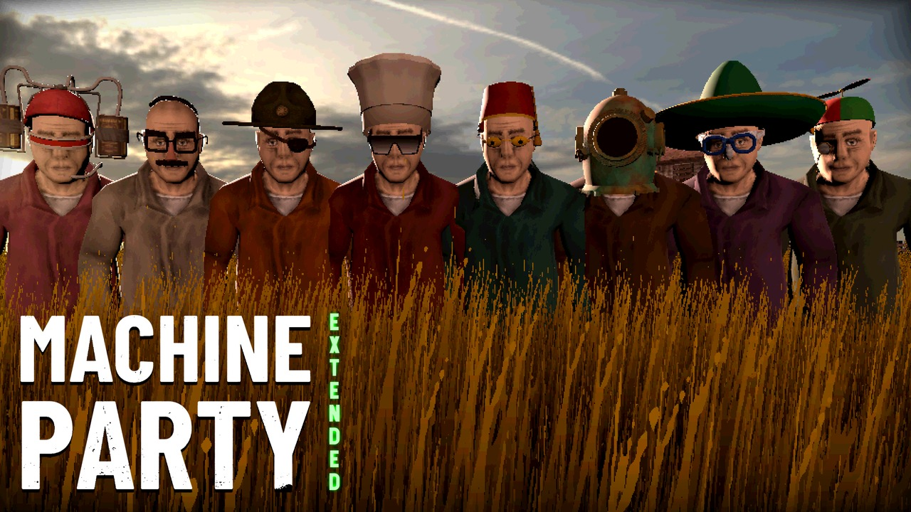

# Machine Party mods

[](https://youtu.be/rwQyxxX0Bdo)

Mods for Machine Party's local (couch) multiplayer, built for [MachinePartyModLoader](https://github.com/Krunk-theduck/MachinePartyModLoader). Better Couch Lobby, More Cosmetics and GameCube Controller Support override no game script, so other mods stack with them. **[▶ Watch the trailer](https://youtu.be/rwQyxxX0Bdo)**

| Mod | What it does |
| --- | --- |
| [Better Couch Lobby](#better-couch-lobby) | A Polaroid close-up of every local player's character in the couch lobby, and a glasses row in each player's outfit picker (replaces Local Glasses) |
| [More Cosmetics](#more-cosmetics) | 13 hats, 6 glasses and 5 suit colours, in the local lobby and on the online customization screen |
| [GameCube Controller Support](#gamecube-controller-support) | Makes GameCube controllers on a USB adapter play like any other pad, with GameCube buttons in the prompts |
| [Machine Party: Extended](../README.md) | Up to 8 players, on one couch or online; its zips come with these mods |

AI assisted: written with Claude (Anthropic's AI model) under my direction and tested by me in the game.

## Requirements
- A legitimate Steam copy of Machine Party (Steam app 4108000). Pirated copies are not supported, and piracy is strictly prohibited.
- [MachinePartyModLoader](https://github.com/Krunk-theduck/MachinePartyModLoader) v3 or newer, installed and run once.

## Install
1. Download a mod's zip from the [Releases page](https://github.com/therenow9/MachineParty-Extended/releases): `BetterCouchLobby-<version>.zip`, `MoreCosmetics-<version>.zip` or `GameCubeControllerSupport-<version>.zip`.
2. Extract it into `<game>/mods/` (`<game>` is the folder with `Machine Party.exe`), so the mod's folder (`couch_lobby`, `more_cosmetics` or `gamecube_support`) sits directly in `mods/`.

To check a mod loaded, press `~` in game and type `mods`. It should be listed with its version. To uninstall a mod, delete its folder from `mods/`.

For 8 players, the zips of [Machine Party: Extended](../README.md) come with Better Couch Lobby and More Cosmetics, with or without GameCube Controller Support, all inside its one folder, `mods/machine_party_extended`. With Extended installed you don't need Better Couch Lobby's or More Cosmetics' own zip, or GameCube Controller Support's if you picked Extended's `-with-GameCube` zip. Extended starts them itself, so `mods` in the console lists only `mp8_support`; the loader's notes (`%APPDATA%\Godot\app_userdata\Machine Party\modloader.log`) say `mp8_support: hosting <id> v<version>` for each one. Don't install one of these mods' own zips beside the bundle: that separate copy runs and the bundle's stays off, and the notes say so.

---

## Better Couch Lobby
Not needed if [Machine Party: Extended](../README.md) is installed: both of its zips already include it. Also on [Nexus Mods](https://www.nexusmods.com/machineparty/mods/15).

Machine Party's local lobby seats everyone in a grimy waiting room, slouched on their chairs. That's hard to read when you're picking an outfit, and the lobby has no glasses at all. This mod keeps the room as it is and adds two things:

- **A Polaroid of every seated player** along the bottom of the screen, over the players' feet. Each one is a still photo of your character standing upright, through the character-select screen's own camera angle and zoom, against the room's own back wall. The zoom stays the same whatever hat you wear. It shows your hat, glasses and suit colour as you change them, More Cosmetics' items included. The room's grime filter covers the photos too.
- **A glasses row** in each local player's picker: none, sunglasses, reading glasses (and More Cosmetics' glasses when it is installed). It works with a controller (up/down to the row, left/right to change) and with mouse and keyboard (click the arrows). The Maska helmet can't be worn with glasses, as online, so picking it clears them and dims the row. Glasses stay on when you return to the lobby after a match, carry into every minigame, and stay out of your own view in split-screen first-person minigames (Chisel Gauntlet).

When the Polaroids would sit under the lobby's buttons (LEAVE, and in a custom game START, PLAYLIST and SKIP INTRO), the buttons move up just above them. With four players in a normal game nothing moves.

**Only the host's pad presses those buttons.** The game hands the lobby's menus to the first seat only when that seat is a controller, so with a keyboard player or an Offline Bots bot in the first seat, anyone's A could press LEAVE and back everyone out. Now the buttons follow the first seat's pad. With no pad there, they follow the pad that steers the menus when GameCube Controller Support has one (`menu_pad: first`, after its first press), and no pad otherwise. Once nobody is seated, the lobby's own bindings come back. The mouse always works; the keyboard too, unless a pad has the first seat (the game takes the keyboard's menu keys away then, as it always has).

**Players keep their seat's place in the match.** The game lines players up in the order they joined, not by seat. So a player who dropped out of the first seat and joined it again was labelled P1 in the lobby but played last in every minigame: last seat, last in the lists. The lobby now keeps its players in seat order, Offline Bots' bots included. A Polaroid also waits for its player's name. On the name screen it would still show the name and outfit of whoever sat there before.

Better Couch Lobby replaces **Local Glasses**, which is no longer released on its own. If `mods/local_glasses` is still installed, delete that folder. Until you do, Better Couch Lobby leaves the glasses row to it, so no panel gets two, and says so in the loader's notes.

### Compatibility
Version 1.0.0's release zip, tested on 2026-11-03 with `cl_selftest` (`DONE fails=0`): from its own zip without Overtime, with the compatibility set and on Machine Party: Extended 1.0.0 (b105), and from inside both of Extended 1.0.0's bundles, and with the compatibility set from the GameCube one. Version 0.4.0's zip, with the change that lets Machine Party: Extended's one-folder bundle host it, tested on 2026-11-03 with `cl_selftest` (`DONE fails=0`): from its own zip without Overtime, with the compatibility set and on Extended's b100, and from inside both of Extended 0.22.0's bundles on b100, and with the compatibility set from the GameCube one. Version 0.4.0's first zip (replaced before release), tested on 2026-11-02 with `cl_selftest` (`DONE fails=0`): from its own zip without Overtime, on stock Overtime 1.7 and with the compatibility set (each with the other two of ours installed), and from Machine Party: Extended 0.22.0's bundle on b95. Version 0.4.0 (players kept in seat order, a Polaroid waits for its player's name), tested on 2026-10-26 with `cl_selftest` (`DONE fails=0`) without Overtime, with the compatibility set and on Machine Party: Extended 0.19.0's b56; its new checks failed with the two changes edited out. Not run on our fork, and not yet played with real pads. Version 0.3.0 (only the host's pad presses the lobby's buttons), tested on 2026-10-10 with `cl_selftest` (`DONE fails=0`) without Overtime, with the compatibility set, on 8 Player Support and on 8 Player Support with the compatibility set; its lobby-buttons checks failed on 0.2.1 with a keyboard or bot host. Not yet run on stock Overtime or our fork, and not yet played with real pads. Version 0.2.1 (head-on photos), tested on 2026-10-10 with the headless self-test (`cl_selftest`, `DONE fails=0`) on 8 Player Support, our Overtime fork and without Overtime, and rendered in game with 8 Player Support (8 seats). Version 0.2.0 was tested on 2026-10-09 in every combination below, and rendered without Overtime (4 seats) too. Not yet tested without More Cosmetics, and not yet played with real pads.

| Mod | Version | Result |
| --- | --- | --- |
| [MachineParty+](https://github.com/Ghostx10742/MachineParty-Plus) | 2.1.0 | Compatible (online-only, no overlap) |
| [First Person View](https://github.com/Krunk-theduck/MachinePartyFPVmod) | 2.1.0 | Compatible (FPV turns itself off in local play) |
| [Offline Bots](https://github.com/Ghostx10742/MachineParty-Bots) | 2.0.0 | Compatible; bots keep their own rolled glasses |
| Machine Party: Extended, until 0.17.0 named 8 Player Support (our own build of Overtime with local-play fixes and one pick of each minigame; build b12, b14 tested 2026-10-09, 0.7.0's b15 and 0.8.0's b18 and b19 and 0.9.0's b21 on 2026-10-09; b21 again on 2026-10-10 with 0.3.0's lobby buttons, alone and with the others; 0.10.0's b23 on 2026-10-10, alone and with the others; 0.11.0's b24 and b25 on 2026-10-11, alone and with the others; 0.12.0's b26 on 2026-10-15, alone; 0.13.0's b33 on 2026-10-15, alone; 0.15.0's b41 on 2026-10-19, alone; 0.16.0's b49 and b50 on 2026-10-20, alone; 0.17.0's b52 on 2026-10-21, alone; 0.18.0's b54 on 2026-10-21, alone; 0.19.0's b56 on 2026-10-26 with 0.4.0, alone; 0.20.0's b57 and b58 on 2026-10-28, alone; 0.21.0's b59 on 2026-10-28, alone; 0.22.0's b60, b62, b63, b65, b66, b67, b68, b69, b70, b71, b72, b73, b74, b75, b76, b77, b78, b79, b80, b81, b82 and b83 (in progress) on 2026-10-29 and 30, alone; b95 on 2026-11-02, from its release bundle with the others of ours; b100 on 2026-11-03, hosted in its one-folder bundle, alone and with the compatibility set; 1.0.0's b105 on 2026-11-03, from its release bundles, alone and with the compatibility set) | 1.0.0 | Compatible; all 8 seats get a glasses row and a Polaroid |
| More Cosmetics | 1.0.0 (tested 2026-11-03, both in Extended's 1.0.0 bundle) | Compatible; its hats, glasses and colours show in the Polaroids and its glasses join the row |
| GameCube Controller Support | 1.0.0 (tested 2026-11-03, both in Extended's 1.0.0 bundle) | Compatible; the lobby's buttons follow its menu pad when no pad has the first seat |
| Without Overtime (vanilla scripts) | | Compatible |
| All of the above together | | Compatible |

---

## More Cosmetics
Not needed if [Machine Party: Extended](../README.md) is installed: both of its zips already include it. Also on [Nexus Mods](https://www.nexusmods.com/machineparty/mods/16).

Adds 13 hats, 6 glasses and 5 suit colours to the game's own, for local and online play.

- **Hats:** a propeller beanie, an army helmet, a diving helmet, a chef's hat, a captain's hat, a sombrero, a doctor's head mirror, a fez, a kippah, a trapper hat, a vintage football helmet, a beret and a Dragonborn helmet. The diving helmet and the Dragonborn helmet can't be worn with glasses, like the game's Maska helmet.
- **Glasses:** disguise glasses, a cyclops visor, a monocle, an eyepatch, tanning goggles and scuba goggles.
- **Suit colours:** teal, pink, off-white, brown and orange.

**In the local lobby** the new hats and colours come after the game's own as you step through them (and after Overtime's colours, when it is installed). The glasses are picked in [Better Couch Lobby](#better-couch-lobby)'s glasses row. **Online,** the customization screen lays every hat and glasses out in one grid of 7 columns, the game's first, with the new colours in a row under the game's swatches.

The items are worn wherever your character is: in every minigame, on the hat that flies off when you die, and the suit colour on your first-person hands in Chisel Gauntlet and Duck Hunt and on your legs in Exploding Collar Race. Online, the mod adds no network calls: the game's own outfit sync carries the new items' names, and a player without the mod should see them as no hat, no glasses and a blue suit, the game's own fallback (not yet checked in an online match).

**Uninstalling:** delete `mods/more_cosmetics` (in Machine Party: Extended's bundle it is `mods/machine_party_extended/more_cosmetics`, and goes with the bundle). If your saved outfit has one of its items, the game loads it as no hat (or no glasses) and a blue suit until you pick another. The choice stays in your save file.

### Compatibility
Version 1.0.0's release zip, tested on 2026-11-03 with `xc_selftest` (`DONE fails=0`): from its own zip without Overtime, with the compatibility set and on Machine Party: Extended 1.0.0 (b105), and from inside both of Extended 1.0.0's bundles, and with the compatibility set from the GameCube one. Version 0.2.2's zip, with the change that lets Machine Party: Extended's one-folder bundle host it, tested on 2026-11-03 with `xc_selftest` (`DONE fails=0`): from its own zip without Overtime, with the compatibility set and on Extended's b100, and from inside both of Extended 0.22.0's bundles on b100, and with the compatibility set from the GameCube one. Version 0.2.2's first zip (replaced before release), tested on 2026-11-02 with `xc_selftest` (`DONE fails=0`, 242 checks): from its own zip without Overtime, on stock Overtime 1.7 and with the compatibility set, and from Machine Party: Extended 0.22.0's bundle on b95, each time with Better Couch Lobby and GameCube Controller Support installed. Version 0.2.2 was also tested on 2026-10-10 on 8 Player Support's b22 and b23. Version 0.2.0 was tested on 2026-10-10 on 8 Player Support's b21 alone and with the compatibility set, on our fork's b7, and without Overtime. Not yet played online with a player who doesn't have the mod, and not yet played with real pads.

| Mod | Version | Result |
| --- | --- | --- |
| [Offline Bots](https://github.com/Ghostx10742/MachineParty-Bots) | 2.0.0 | Compatible (0.2.0, 2026-10-10); its bots wear only the game's own items |
| [First Person View](https://github.com/Krunk-theduck/MachinePartyFPVmod) | 2.1.0 | Compatible (0.2.0, 2026-10-10) |
| [MachineParty+](https://github.com/Ghostx10742/MachineParty-Plus) | 2.1.0 | Compatible (0.2.0, 2026-10-10) |
| [Machine Party: Extended](../README.md) (1.0.0's b105, 2026-11-03, from its release bundles, alone and with the compatibility set; b100, 2026-11-03, hosted in its one-folder bundle, alone and with the compatibility set; b95, 2026-11-02, from its release bundle; earlier 8 Player Support b21 to b23, 2026-10-10) | 1.0.0 | Compatible |
| Better Couch Lobby | 1.0.0 (tested 2026-11-03, both in Extended's 1.0.0 bundle) | Compatible; its Polaroids show the new items and its glasses row offers the new glasses |
| GameCube Controller Support | 1.0.0 (tested 2026-11-03, both in Extended's 1.0.0 bundle) | Compatible |
| Without Overtime (vanilla scripts) | | Compatible (2026-11-03, from the release zip) |

---

## GameCube Controller Support
Already included in [Machine Party: Extended](../README.md)'s `-with-GameCube` zip, so it isn't needed with that one. Extended's other zip doesn't include it.

Makes GameCube controllers on a USB adapter play like any other pad in Machine Party, and shows GameCube buttons in the game's controller prompts.

- **Nintendo-style buttons:** B is back/unready and X is action 3, as on a GameCube. Mayflash adapters in PC mode already report them that way; clone adapters report them by position, the other way round, and the mod swaps them back.
- **B backs out of the main menu too,** where the game uses X's spot; a GameCube pad's X doesn't back out there. Other pads keep the game's own buttons.
- **B drops you out of the couch lobby** from your name screen. In the outfit panel B goes back to the name screen, as in the game, and a second B leaves the seat. Start still drops out as before, and other pads keep Start only.
- **Full-range sticks:** GameCube sticks only reach about three quarters of an Xbox stick's range. Each pad is calibrated as you play, so Duck Hunt aiming and Forklift steering and pedals are as fast as on any other pad. The triggers are rescaled so a released trigger reads 0 and a full squeeze reads 1.
- **L click = LB:** the adapter's mapping doesn't pass L's full click on to the game, so squeezing L all the way works as LB.
- **Duck Hunt look speed on the D-pad:** a GameCube hunter turns the look speed down with D-pad Left and up with D-pad Right, and their look-speed prompt shows the D-pad. For that player the D-pad no longer aims (aiming is the stick alone), and L click and Z no longer change the look speed.
- **X and Y in The Filter:** X burns like A and Y recycles like B, so both hands can use buttons of the same size. A and B still work. The minigame's controls page lists them as "A / X  Burn" and "B / Y  Recycle" while it shows GameCube buttons. With the `positional` layout only A and B do, and the page lists only those.
- Both minigame changes apply to GameCube pads only, in couch and online play, with or without Overtime. Other pads play as before.
- **Prompts:** the minigame controls page shown before each round, and Duck Hunt's "adjust look speed" prompt, are the only places the game shows controller buttons. Both show GameCube buttons when a GameCube pad is in use. With mixed controllers they follow whichever pad pressed a button last, switching at most once a second so an 8-player game doesn't flicker. The exception is a GameCube hunter's own look-speed prompt, which always shows the D-pad.
- **Art:** the default `classic` set keeps the game's thin white-outline look in the GameCube layout: big A, small B, kidney-shaped X and Y, with the prompted button filled in. Three alternates are included:
  - `outline`: bold outlined shapes with letters
  - `authentic`: the same shapes in GameCube colours
  - `letters`: a white circle with a letter
- **Extra-controller warning:** some adapters show up as many more pads than they have ports, which hides other controllers. The mod detects this and tells you how to fix it (see [Adapter setup](#adapter-setup)).

**What each GameCube button does** (adapter in PC mode, default `nintendo` layout):

| GameCube | Game sees | Used for |
| --- | --- | --- |
| A | South face | Confirm, action 1, join |
| B | East face | Back / unready, action 2; back on the main menu; on the lobby's name screen, drop out |
| X | West face | Action 3 (not back on the main menu); burns in The Filter |
| Y | North face | Action 4; recycles in The Filter |
| Z | RB | Right shoulder, add to playlist (not look speed in Duck Hunt) |
| L, squeezed until it clicks | LB | Left shoulder, remove from playlist (not look speed in Duck Hunt) |
| L / R, analog | LT / RT | Triggers (Forklift pedals, Duck Hunt zoom and shoot) |
| Control stick, D-pad | Left stick, D-pad | Movement, menus; a Duck Hunt hunter's D-pad Left / Right is look speed |
| Start | Start | Pause, drop out of the lobby |
| C-stick | Right stick | Unused by the game |

R's full click and Back aren't used by the game, so nothing is lost.

### Adapter setup
- **Use PC mode.** Set the adapter's mode switch to PC (on Mayflash adapters it's labelled Wii U / PC). PC mode needs no driver.
- **Don't install Mayflash's own Windows driver.** It crashes Steam. If you installed it, uninstall it and use PC mode.
- **Wii U / Switch mode and XInput mode:** in those modes the pads still get GameCube prompts, but the button, stick and L-click fixes don't apply. XInput mode has a further catch: Windows allows only 4 XInput controllers in total. Four Xbox-style pads plus four GameCube pads in XInput mode won't all work, so stay in PC mode for 8 players.
- **If the adapter shows up as extra controllers** (one adapter as up to 16 pads, or other controllers going missing while it's plugged in), the mod warns you on screen. SDL, the controller library the game uses, has a GameCube driver that can claim the adapter several times over. To turn it off:
  1. Run `fix-gamecube-adapter.bat` in the mod's folder: `mods/gamecube_support/`, or `mods/machine_party_extended/gamecube_support/` in Machine Party: Extended's bundle. It sets the user environment variable `SDL_JOYSTICK_HIDAPI_GAMECUBE=0`.
  2. **Fully exit Steam** (tray icon, then Exit) and start it again. Games launched from Steam only see the variable after that.
  3. To undo it, run `undo-gamecube-adapter-fix.bat` and restart Steam.

### Settings
| Way | How |
| --- | --- |
| Hotkey | **F9** cycles the prompt style: auto → gamecube → xbox. A short note at the top of the screen shows the new setting. |
| Console | With the Debug Console mod, press `~` and type `gc` for the current settings. Use `gc style auto\|gamecube\|xbox`, `gc art classic\|outline\|authentic\|letters`, `gc layout nintendo\|positional`, or `gc pads` to list controllers, how each is handled and its calibrated stick range. |
| Config file | `%APPDATA%\Godot\app_userdata\Machine Party\gamecube_support.json` is created on first launch. The hotkey and console save to it. Settings from the older `gamecube_prompts.json` carry over. |

Config keys:

| Key | Default | Meaning |
| --- | --- | --- |
| `button_layout` | `"nintendo"` | `nintendo` (B = back) or `positional` (X, right of A, = back, as a clone adapter reports it) |
| `stick_calibration` | `"auto"` | `auto` (learns each pad's range as you play), `fixed` (uses `stick_range`), or `off` |
| `stick_range` | `0.75` | Stick value treated as full. In `auto` this is the starting point, and it only grows. Below 0.5 the stick still reads just under 0.5 until the pad itself reports 0.5, so menus don't press twice. |
| `trigger_rest` | `0.07` | Trigger value treated as released. Set to 0.2 or more, a trigger between 0.2 and this value still reads 0.2, because the game already counts it as pressed there. |
| `l_click_from_trigger` | `true` | Squeezing L past `l_click_threshold` presses LB. Turns itself off for a pad that sends a real LB. |
| `l_click_threshold` | `0.85` | How far L must go for LB. It releases 0.1 lower. |
| `adapter_overrides` | `{}` | Correct an adapter's profile, such as `{"0079:1846": {"face": "nintendo", "has_lb": true}}`, if a probe shows it differs. `face` is how the adapter reports B and X: `nintendo` (Mayflash, `0079:1843` and `0079:1844`) or `positional` (clones, `0079:1846` and `0079:1847`) |
| `warn_duplicates` | `true` | Show the extra-controller warning |
| `menu_pad` | `"first"` | Which pads steer the menus. `first`: the first pad to press a button after launch (any kind), until it disconnects; in the local lobby the host's pad has them, and the main menu takes them back. `any`: every pad, until a local lobby hands them to its host. `off`: the game's own rule (the first controller connected). Read at launch. Replaces `menus_any_pad` (`true` becomes `first`, `false` becomes `off`). |
| `style` | `"auto"` | Prompts: `auto`, `gamecube` (always), or `xbox` (always vanilla) |
| `art` | `"classic"` | `classic`, `outline`, `authentic` or `letters` |
| `auto_cooldown_sec` | `1.0` | Minimum seconds between automatic prompt switches |
| `auto_use_sticks` | `false` | Also switch prompts on stick movement, not just buttons |
| `hotkey` | `"F9"` | Godot key name; `""` turns the hotkey off |
| `extra_gamecube_guids` | `[]` | Controller GUIDs to treat as GameCube pads for prompts (see `gc pads`) |
| `glyph_map` | `{}` | Per-slot glyph override, such as `{"controller_button_east.png": "X"}` |

### Compatibility
Version 1.0.0's release zip, tested on 2026-11-03 with `gcs_selftest` (`DONE fails=0`): from its own zip without Overtime, with the compatibility set and on Machine Party: Extended 1.0.0 (b105), and from inside Extended 1.0.0's GameCube bundle, alone and with the compatibility set. Not yet played with real pads from the bundle. Version 1.5.0's zip, with the change that lets Machine Party: Extended's one-folder bundle host it, tested on 2026-11-03 with `gcs_selftest` (`DONE fails=0`): from its own zip without Overtime, with the compatibility set and on Extended's b100, and from inside Extended 0.22.0's GameCube bundle on b100, alone and with the compatibility set. The console's `gc` commands were checked headless only; not yet played with real pads from the bundle. Version 1.5.0's first zip (replaced before release), tested on 2026-11-02 with `gcs_selftest` (`DONE fails=0`): from its own zip without Overtime, on stock Overtime 1.7 and with the compatibility set (each with the other two of ours installed), and from Machine Party: Extended 0.22.0's bundle on b95. Version 1.5.0 (B drops a GameCube player out of the couch lobby from the name screen), tested on 2026-10-26 with `gcs_selftest` (`DONE fails=0`) without Overtime, with the compatibility set and on Machine Party: Extended 0.19.0's b56 (8 seats); Better Couch Lobby's `cl_selftest` also passed. Its drop-out checks failed with the guard edited out. Not run on our fork. Owed on real pads. Version 1.4.0 (the Mayflash's B and X no longer swapped the wrong way, and B backs out of the main menu), tested on 2026-10-26 with `gcs_selftest` (`DONE fails=0`, 233 checks without Overtime, 235 on Machine Party: Extended 0.18.0's b55), with the compatibility set, without Overtime and on Extended; Better Couch Lobby's `cl_selftest` also passed. Not run on stock Overtime or our fork. Owed on real pads with the Mayflash. Version 1.3.0 (one menu pad, `menu_pad`), tested on 2026-10-10 with `gcs_selftest` (`DONE fails=0`) without Overtime, with the compatibility set and on 8 Player Support. Not yet run on stock Overtime or our fork; the first-press claim and a disconnect are checked headless through the mod's own functions, and are owed on real pads. Version 1.2.0, tested on 2026-10-08 with the headless self-test (`DONE fails=0`: 196 checks with stock Overtime 1.7, with our Overtime fork, with 8 Player Support and with everything together, 194 without Overtime, where its two Overtime checks skip). Local Glasses' and More Cosmetics' self-tests also passed with our fork, with 8 Player Support, without Overtime and with everything together. The Filter's controls page was rendered in game with 8 Player Support in all four art sets. Pads aren't visible headless, so the controller fixes are covered by the self-test's logic checks, a simulated pad driven through the live correction loop, and the probe on real hardware. 1.1.0's Duck Hunt D-pad and The Filter's X and Y have been played on a real pad with 8 Player Support (below).

| Mod | Version | Result |
| --- | --- | --- |
| Debug Console | 1.0.0 | Compatible; adds `gc` commands |
| Machine Party: Extended, until 0.17.0 named 8 Player Support (our own build of Overtime with local-play fixes and one pick of each minigame; builds b5, b7, b9 and b12 tested 2026-10-08, b14 on 2026-10-09, alone and with the others; 0.7.0's b15 on 2026-10-09, alone; 0.8.0's b18 and b19 and 0.9.0's b21 on 2026-10-09, alone and with the others; b21 again on 2026-10-10 with 1.3.0's menu pad, alone; 0.10.0's b23 on 2026-10-10, alone; 0.11.0's b24 and b25 on 2026-10-11, alone and with the others; 0.12.0's b26 on 2026-10-15, alone; 0.13.0's b33 on 2026-10-15, alone; 0.15.0's b41 on 2026-10-19, alone; 0.16.0's b49 and b50 on 2026-10-20, alone; 0.17.0's b52 on 2026-10-21, alone; its title word hooks the main menu as this mod does; 0.18.0's b54 on 2026-10-21, alone; b55 on 2026-10-26 with 1.4.0, alone; 0.19.0's b56 on 2026-10-26 with 1.5.0, alone; 0.20.0's b57 and b58 on 2026-10-28, alone; 0.21.0's b59 on 2026-10-28, alone; 0.22.0's b60, b62, b63, b65, b66, b67, b68, b69, b70, b71, b72, b73, b74, b75, b76, b77, b78, b79, b80, b81, b82 and b83 (in progress) on 2026-10-29 and 30, alone; b95 on 2026-11-02, from its release bundle with the others of ours; b100 on 2026-11-03, hosted in its one-folder bundle, alone and with the compatibility set; 1.0.0's b105 on 2026-11-03, from its release bundles, alone and with the compatibility set) | 1.0.0 | Compatible |
| Better Couch Lobby | 1.0.0 (tested 2026-11-03, both in Extended's 1.0.0 bundle) | Compatible; it reads the menu pad for the lobby's buttons |
| More Cosmetics | 1.0.0 (tested 2026-11-03, both in Extended's 1.0.0 bundle) | Compatible |
| [Offline Bots](https://github.com/Ghostx10742/MachineParty-Bots) | 2.0.0 | Compatible; bots never switch the prompt style |
| [First Person View](https://github.com/Krunk-theduck/MachinePartyFPVmod) | 2.1.0 | Compatible |
| [MachineParty+](https://github.com/Ghostx10742/MachineParty-Plus) | 2.1.0 | Compatible |
| Without Overtime (vanilla scripts) | | Compatible |
| All of the above together | | Compatible |

**Hardware:**
- **Mapped with `tools/joyprobe`:** a ShanWan-made clone adapter (`0079:1846`) in PC mode, alongside an 8BitDo Ultimate 2 in XInput mode. That adapter needed the extra-controller fix.
- **Menu navigation** (D-pad and stick, main menu and online lobby) checked by playing on that adapter, 2026-10-05.
- **Minigame controls** played on that adapter with 8 Player Support 0.5.0 and 7 bots, 2026-10-08: in The Filter, X burns and Y recycles, and A and B still do. In Duck Hunt, as one of two hunters, the D-pad steps look speed and doesn't aim, L click and Z do nothing, the stick aims, and the prompt shows the D-pad inside the split-screen tile.
- **Not yet tested:** those minigame controls without Overtime, with an 8BitDo hunter alongside, after a mid-match replug, and online; a probe of a genuine Mayflash adapter (one has been played with: in PC mode it shows up as `0079:1844`, 3 pads through two couch matches on 2026-10-08). If its buttons turn out to differ, an `adapter_overrides` entry covers it without a code change.

---

## Development
```powershell
pwsh ./tools/install.ps1 -ModId <id> [-Uninstall]   # copy a mod from the repo into <game>/mods
pwsh ./tools/make_release.ps1                       # the release zips, into dist/
```
```bash
bash tools/run_selftest.sh <test>                   # a headless self-test, from tools/selftest/
```

## Credits
Machine Party is by Mike Klubnika and GDeavid. These mods install through [MachinePartyModLoader](https://github.com/Krunk-theduck/MachinePartyModLoader) by Krunk-theduck, and their couch tests seat [Offline Bots](https://github.com/Ghostx10742/MachineParty-Bots) by Ghostx10742. Machine Party: Extended, whose zips bundle them, builds on [Machine Party Overtime](https://github.com/DarkJadeStone/MachineParty-Overtime) by DarkJadeStone and [machine-party-8p](https://github.com/Binary1936/machine-party-8p) by Binary1936 and contributors; `NOTICE.md` has the full credit.

Special thanks to DarkJadeStone, for Machine Party Overtime; Binary1936, for machine-party-8p; and Mike Klubnika and GDeavid, for Machine Party.

## License
The project's own work is under the MIT license (`LICENSE`). `NOTICE.md` says what that covers and what it can't. This is an unofficial fan modification, not affiliated with or endorsed by the game's developer or publisher.
